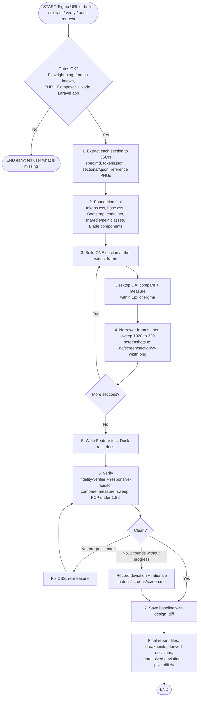

# Plugin flow: when it starts and when it ends

## Start

The workflow starts when the user does one of these:
- pastes a `figma.com` URL, or
- asks to build a screen, extract tokens, verify fidelity or check responsiveness, or
- runs `/figma-to-web:build-screen`, `extract-tokens`, `verify-fidelity`, `check-responsive` or `setup-figwright`.

## End

The workflow ends only after step 7: the report is delivered and the `design_diff` baseline is saved. It also ends early, with a clear message, if a start gate fails (see "Early stops").

## Early stops

| Where | Stops when | What the plugin does |
|---|---|---|
| Figwright | `ping` fails or the Figma plugin is not connected | Tells the user to open the file and run Plugins, Development, Figwright |
| Frames | no URL or selection, or breakpoint unknown | Asks the user; never builds from a screenshot |
| Tools | PHP, Composer or Node missing | Tells the user before writing code |
| Read tool | a Figma node cannot be read | Reports it; never guesses the value |

## Later changes

After the first finish, any component fix or redesign re-enters at step 4: edit, then rerun the 1920px to 320px sweep until it is clean. A changed Figma design is found with `design_diff`, and only the affected code is edited.
